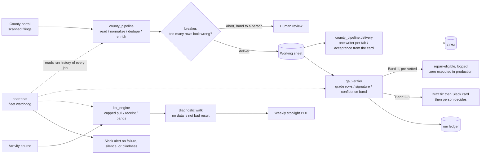

# operations-automation-platform

**I map how work gets done, build the AI-powered system that does it, and measure what changed.**

This repo holds reference implementations of an automation platform I designed, built and operate for a
small real-estate business: sixteen workstreams running as 16 GitHub Actions workflows (8 on a
schedule, the rest on demand from Slack or as CI checks) plus services on a cloud scraping host, two
app hosts and an edge platform. They pull public
records, verify their own output, rank work, and report results, with a human approving anything risky
(**measured**, counted from the production repo 2026-09-25; the profile's 17 is the 2026-09-16 count,
before a CI check was folded into another workflow). Each build starts with the current-state process,
the requirements and the acceptance criteria, written down before any code. It reads as one method:

| Stage | Case study | What it demonstrates |
|---|---|---|
| **Automate** — redesign the work | [County records pipeline](docs/county-pipeline.md) | Replaces manual document processing with scheduled ingestion, reconciliation, business rules, and human exception handling |
| **Validate** — make the process trustworthy | [QA Verifier](docs/qa-verifier.md) · [Ops Heartbeat](docs/ops-heartbeat.md) | Independently checks output quality and execution reliability, detects silent failures, and escalates uncertainty; one daily card grading every registered pipeline (live since 2026-09-28) |
| **Improve** — turn results into decisions | [KPI engine + diagnostic](docs/kpi-engine.md) | Defines performance metrics, investigates root causes, and uses operational evidence to guide process changes |

> **Reference implementation of a system I run in production. Production code is private.**
> The incidents, numbers and decisions in the case studies are from the real system, with names,
> IDs and business specifics replaced. One exception: `heartbeat/` is the real code, generalized.

Every outcome or impact claim in this repo carries a tag: **measured** (logged), **goal** (a target, not a result),
**recollection** (my account, not a log), or **finding** (a result on synthetic data).

## What the platform demonstrates

| Capability | Where it is proved |
|---|---|
| Business process analysis and design | As-is → to-be and acceptance criteria on every case study; the directive's stated target in [county-pipeline](docs/county-pipeline.md) |
| Data ingestion and normalization | [County records pipeline](docs/county-pipeline.md): fetch only what changed, vision read, composite key, second-source enrichment |
| Record reconciliation and exception management | Blank-and-flag invariant, review queue with a reason, "fetched = duplicates + written + queued", stack-don't-skip ([tests](tests/test_county_pipeline.py)) |
| Workflow orchestration | 16 workflows (8 scheduled), Slack-driven on-demand jobs, one writer per tab, five-weekday parallel-run cutover |
| Quality assurance and validation | [QA Verifier](docs/qa-verifier.md): every run graded by its rows, 37 unattended runs, zero auto-fixes by design; 118 tests |
| Operational monitoring and reliability | [Ops Heartbeat](docs/ops-heartbeat.md): first live run found four problems nobody knew about; the August seven-day silent timeout |
| Performance analytics and process improvement | [KPI engine](docs/kpi-engine.md): diagnostic order before anyone is coached; a diagnosis, a rule change, and the metric that moved |
| Solution evaluation and prioritization | [Build vs. buy](docs/build-vs-buy.md): eight areas scored, two bake-offs, a cost gate; [build velocity](docs/build-velocity.md): the data refuted the theory |

## Platform scale
Sixteen workstreams on 16 workflows (**measured**, 2026-09-25): eight scheduled (daily, weekday and
weekly jobs), the rest on demand from Slack or as CI checks, plus services on a cloud scraping host,
two app hosts and an edge platform. Every scheduled job is watched from outside by the Heartbeat, and
every registered data pipeline is graded daily by the Verifier. The fleet grows, so each case study
cites the job count on its own date.

<details><summary>Workflow inventory (one line each; the three case studies above are the ones with write-ups)</summary>

| Workstream | What it does | Runs |
|---|---|---|
| County records scraper | Pulls new public filings from several county sites daily, reads scanned documents with an AI vision model, dedupes, cross-checks a second source, writes clean rows | Scheduled, cloud actor |
| Scraper watchdog | Confirms every morning that the scraper actually ran; the cloud host can kill a run at timeout with no error | Weekdays |
| QA Verifier | Grades every registered pipeline's output, drafts fixes, reports in plain English, keeps a ledger | One card every weekday |
| Ops Heartbeat | Watches every scheduled job from outside all of them | Daily |
| Tax-roll pipeline | Periodic bulk refresh of parcel data used for matching and calibration | Periodic |
| Recently-sold sweep | Weekly check that removes records already sold from the working lists | Weekly |
| Explainable prioritization | Weekly ranking of the work queue with reasons shown; read-only by default | Weekly + Slack |
| KPI engine | Nightly activity pull into a shared sheet, with a delivery receipt | Nightly |
| KPI weekly / monthly reports | Stoplight report with a written diagnosis, delivered as a PDF | Weekly, monthly |
| Caller monitoring | Weekday morning pulse on team activity | Weekdays |
| CRM delivery bridge | Writes qualified rows into the CRM, replacing a daily manual upload; cutover in progress | Daily |
| Build-velocity analysis | Investigation into why builds took 2–3 weeks. [Write-up](docs/build-velocity.md) | — |

The remaining workstreams cover intake and follow-up for the business and stay private with no write-up.
</details>

## Supporting analyses
- [Build vs. buy](docs/build-vs-buy.md) — discovery-to-spec: a scoped technical decision with success metrics, evaluating an off-the-shelf platform area by area.
- [Build velocity](docs/build-velocity.md) — root-cause investigation where the data refuted the theory ("we review too much").

## How it fits together



Solid arrows are data. Dotted arrows are the Heartbeat reading each job from outside, so a job that
never started still produces an alert. Every branch that could be wrong ends at a person. The Band 1
node is a lane decision: the reference code decides whether a fix is eligible to run; it does not run one.

## Run it

```bash
pip install -r requirements.txt
python -m pytest -q          # 118 passed
# mutation check: delete the blindness counter in heartbeat/ops_heartbeat.py; test_a_fleet_that_403s_on_every_job_exits_RED must fail
python -m heartbeat.demo   # grades two synthetic fleets offline; the --repo form needs GITHUB_TOKEN
python -m heartbeat.ops_heartbeat --repo owner/name   # needs GITHUB_TOKEN; add --post to send to Slack
python -m qa_verifier.demo       # grades synthetic runs, prints the Slack cards and the ledger
python -m county_pipeline.demo   # three synthetic days incl. an aborted batch and the CRM stage
python -m kpi_engine.demo        # weekly stoplight report with the diagnostic walk
```

## Built with
I designed, directed, tested and operate this system. Every workflow on it was built by directing AI
coding tools (Claude Code) against written rules and acceptance tests; in the workflows shown here, AI is
limited to the document reader, and every grading and routing decision is code a test can pin.
No third-party code is included. This repo is a clean-room reconstruction of private production
code, published as a single commit; the original history stays with the production repo.
